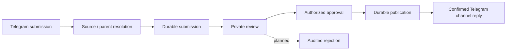

# CatsChannel

CatsChannel is a Python 3.11 / aiogram Telegram system for collecting, reviewing
and publishing cat videos in source-aware reply chains.

## Current status

Intake, durable publication and approve-only private review are implemented in
merged PRs [#36](https://github.com/SoloMidMiram/CatsChannel/pull/36),
[#37](https://github.com/SoloMidMiram/CatsChannel/pull/37) and
[#38](https://github.com/SoloMidMiram/CatsChannel/pull/38).
The November 1, 2026 bounded private pilot records successful review, actual admin
approval and one confirmed exact-parent publication. Its
[merged acceptance receipt](https://github.com/SoloMidMiram/CatsChannel/blob/645229aa3b150fed3231358c44c1d8209c5c5a74/docs/evidence/telegram-hosted-private-acceptance-2026-11-01.md)
is recorded evidence, not an independently repeated run or sustained production acceptance.

**Public deployment remains blocked** by incomplete moderation and enforced
inspection/publication isolation. The private pilot used one restricted channel
for both roles. Supported runtime scope is one application process.

## Features

- Telegram-native submission through `/post` and opaque exact-post reply links.
- Logical threads per stable source, normal source-tail appends and exact-parent
  branches that retain their selected parent and truthful media provenance.
- Durable submissions, placement intents, publication attempts and confirmed
  Telegram projections, with SQLite and PostgreSQL support.
- Private review copies, authorized version-aware approval and persisted audit.
- Bot-specific Telegram `file_id` reuse without downloading hosted videos.
- Explicit metadata-only checks for hosted media; full decoding, manifest integrity
  and digest requirements for local-library media.
- Duplicate-send safeguards, conservative unknown outcomes, operator reconciliation
  and independent reply-button/navigation repair.
- Offline dispatcher, persistence, concurrency and recovery tests, plus PostgreSQL CI.

## How it works



Review delivery does not finalize placement. Children require their exact parent's
confirmed destination projection; an unavailable parent never silently becomes a root.

## Architecture

Telegram handlers translate events into application calls. Application services
resolve sources and lifecycle decisions; domain models represent submissions and
reply chains. Repository interfaces and units of work own persistence. Review and
publication services coordinate durable state; transport adapters own Bot API calls.
Internal post identities remain separate from Telegram projections so logical
placement, inspection delivery and destination confirmation cannot be confused.
See [architecture](docs/ARCHITECTURE.md) and [publication contract](docs/PUBLICATION_CONTRACT.md).

## Installation and development

Use Python 3.11 and `uv`. Follow the [quickstart](docs/QUICKSTART.md) for environment
and local configuration, [database guide](docs/DATABASE.md) for migrations and
[operations](docs/OPERATIONS.md) before running a bot. Keep credentials local.
Use `uv sync --locked --all-extras` for the complete development/CI environment.

```bash
uv sync --locked
uv run --frozen pytest
uv run --frozen ruff check .
uv run --frozen ruff format --check .
uv run --frozen python tools/project_context.py validate
uv run --frozen python tools/project_context.py generate --check
```

## Roadmap

| Workstream | Status |
| --- | --- |
| [Core publishing #7](https://github.com/SoloMidMiram/CatsChannel/issues/7) | Implemented; private acceptance recorded; remaining acceptance open |
| [Complete moderation #8](https://github.com/SoloMidMiram/CatsChannel/issues/8) | Approve-only implemented; rejection, isolation and recovery remain |
| [Reliability #9](https://github.com/SoloMidMiram/CatsChannel/issues/9) | Operational qualification and deployment readiness open |
| [YouTube discovery #17–#22](https://github.com/SoloMidMiram/CatsChannel/issues/17) | Independent planned workstream |
| [Developer tools #35](https://github.com/SoloMidMiram/CatsChannel/issues/35) | Optional integration independent of publishing |

See the [roadmap](docs/ROADMAP.md) and [core epic](https://github.com/SoloMidMiram/CatsChannel/issues/1).

## Validation and limitations

The November 1 receipt records a 23,220,422-byte, 171-second hosted video and zero
`getFile`, media-download or decode calls. Metadata-only evidence
(`full_decode=false`, `sha256=null`) is **not media-byte integrity or safety
verification**. Local-library requirements remain stricter.

The private pilot does not qualify sustained operation, public permissions,
complete moderation or all restart paths. Updates deferred before durable intake
commit are not guaranteed to survive restart. Unknown sends require evidence and
operator reconciliation. Review-caption updates and admin callback answers do not
prove submitter-facing publication acknowledgement.

## Documentation

- [Documentation index](docs/README.md), [development](docs/DEVELOPMENT.md), [contributing](docs/CONTRIBUTING.md)
- [Review approval](docs/REVIEW_APPROVAL.md), [hosted reuse](docs/TELEGRAM_HOSTED_REUSE.md), [publication validation](docs/PUBLICATION_VALIDATION.md)
- [Transport](docs/BOT_API_TRANSPORT.md), [security](docs/SECURITY.md), [media library](docs/MEDIA_LIBRARY.md), [optional Telethon downloader](docs/TELEGRAM_DOWNLOADER.md)
- [Generated context overview](project-context/overview.md), [context usage](project-context/README.md)
- [Post-pilot reconciliation](docs/evidence/post-pilot-reconciliation-2026-11-02.md)
