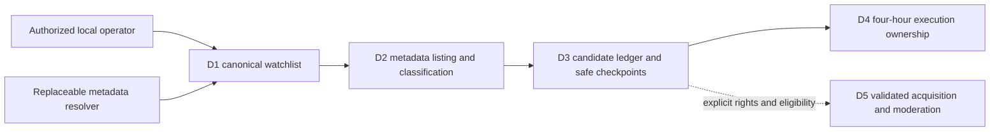

# Approved YouTube watchlist (D1)

D1 adds an independent metadata-only application API based on main
`5cb84a574330c3fa41033356c8882679ba5c3d3c`. It has no production resolver, CLI,
network client, scan, media download, submission or Telegram effect.

## Ownership and normalized identity

| Issue | Owner |
| --- | --- |
| #18 | Canonical watchlist registry, resolution, operator policy and D1 schema |
| #19 | Metadata retrieval and evidence-based Shorts classification |
| #20 | Candidates, runs and checkpoints referencing the D1 channel registry |
| #21 | Four-hour scheduling, leases, catch-up and observability |
| #22 | Permission-gated validated acquisition and moderation handoff |

`(provider="youtube", channel_id="UC" + 22 URL-safe characters)` is the stable
identity. The internal UUID is the future ledger foreign key. Display name and
handle are mutable snapshots; historical aliases never establish current ownership.
URLs are constructed from IDs, never fetched directly. Accepted inputs are IDs,
ASCII handles of 3-30 characters, and HTTPS youtube.com/www.youtube.com
`/channel/ID` or `/@handle` URLs with optional `/shorts` and trailing slash.
Other forms, credentials, ports, queries, fragments and encoded paths are rejected.
Unicode/legacy custom URLs require a separately reviewed normalization extension.

## Operator API and authorization

`WatchlistService(database.unit_of_work, authorization=policy, resolver=adapter)`
requires no Telegram settings. `policy.allows(Operator(name), operation)` is a
synchronous trusted-local authorization callback, supplied by the embedding local
operator application. Missing or denied context fails before resolver calls and
writes. Operator names are bounded audit labels, not remote authentication tokens.
Do not expose this Python API to untrusted clients without a real authentication
boundary. Repositories remain internal trusted persistence interfaces.

```python
from cats_channel.discovery.domain import Operator, ScanPolicy
from cats_channel.discovery.service import WatchlistService

# authorization and resolver are explicit trusted composition dependencies.
watchlist = WatchlistService(database.unit_of_work, authorization=authorization, resolver=resolver)
registration = await watchlist.register("@approvedcat", operator=Operator("owner"))
entry = await watchlist.inspect(registration.entry.id)
await watchlist.set_scan_policy(entry.id, ScanPolicy(30, 30), operator=Operator("owner"))
await watchlist.set_enabled(entry.id, False, operator=Operator("owner"))
changes = await watchlist.history(entry.id)
await watchlist.retire(entry.id, operator=Operator("owner"))
```

Mutations are register, refresh_resolution, set_enabled, set_scan_policy and retire.
Read APIs are inspect, list and history. List uses UUID keyset pagination: pass the
last returned ID as `after`, with limit 1-100. Retirement is terminal and disables
without deleting identity or history. It does not revoke external rights or erase
future candidate records. CLI delivery is a separate narrow follow-up after a
production metadata resolver is qualified.

## Resolution and recovery

The replaceable async ChannelResolver receives only normalized IDs/handles. It must
resolve authoritative metadata and return the validated Resolution DTO; it never
receives arbitrary destinations. D1 supplies synthetic test fixtures, not a live
adapter. Provider awaits have a 30-second timeout outside database transactions;
there are no automatic retries. Cancellation propagates and untrusted exception
payloads are replaced with a bounded temporary_failure outcome.

Outcomes: resolved, unresolved, unavailable (private/deleted/removed), ambiguous,
rate_limited (including quota), temporary_failure and invalid_input. Register
additionally reports registered, already_known and renamed. Evidence is an enum-like
allowlist, not arbitrary response JSON. Retry-after is bounded to 0-86400 seconds.
No resolver yields unresolved/resolver_not_configured, without network access.
Wrong identity returned for an explicit channel ID becomes ambiguous.

Unresolved requests and unresolved explicit IDs are durable but disabled by default.
Resolving a pending request preserves its configured enabled state and scan policy;
operators explicitly enable it when ready. A newly resolved registration is enabled.
Refreshing a known identity preserves enabled state; unavailable sources clear
obsolete display snapshots and are excluded from scanner input. Transient errors
preserve last successful metadata/time but exclude the row until resolved again.
Operators can inspect, correct provider configuration, and explicitly refresh.

## Persistence and concurrency

Migration 0008_discovery_watchlist extends the existing SQLAlchemy/Alembic owner:
watched_channels (unique provider/channel ID), watchlist_requests (unique pending
normalized reference), watchlist_control (serialization row), watchlist_events.
Resolved requests link to canonical entries and cease owning an alias/capacity slot.
inspect of a resolved request follows its canonical link. Reads never infer source
identity from a display name. #20 must reuse watched_channels rather than add a registry.

The existing UoW owns commit, rollback and cancellation cleanup. Repositories flush
but never commit. Each mutation first updates the shared control row, serializing
all registry writers on SQLite and PostgreSQL. This also makes duplicate insertion
idempotent under concurrent/distributed service calls; DB uniqueness is the final
constraint. No process-only lock or second database is introduced.

Capacity defaults to 100 active canonical entries plus unresolved unretired requests.
Disabled entries count; retired entries and linked requests do not. Configure the
same capacity in every trusted service instance. Request resolution transfers a
slot transactionally, including when the registry is full. Expected entry versions
reject stale provider results; alias results older than a target's latest update
cannot replace its snapshot. No identity or audit survives an aborted transaction.

The latest 100 curated change events per entry retain actor, action, status, handle,
evidence, version, enabled/retired state and policy. Older events are pruned; identities
and creation timestamps remain. This is bounded operational history, not an unlimited
compliance archive. Downgrade removes D1 registry/history; export it first if needed.
Existing submission/review/publication rows are preserved by upgrade and downgrade.

## Scanner and D2/D3 contracts

`await watchlist.list(scanner=True, after=cursor, limit=100)` returns only resolved,
enabled, unretired immutable Entry records containing provider/channel identity,
canonical URL, enabled status and ScanPolicy. Metadata-only defaults are a 30-item
page budget and 30-day lookback, with positive bounded operator overrides (1-10000).
These budgets are not completeness guarantees or an implemented scan algorithm.
ProviderConfiguration is injected separately: adapter identifier, timeout and request
budgets. Credentials must stay in runtime secret configuration, never in DTOs/rows.

Candidate carries stable provider/channel/video identity, constructed video URL,
optional bounded title, publication date, duration and geometry, observed time,
method, classification evidence and checkpoint provenance. Classification defaults
to unknown; a short duration alone never establishes Shorts membership.
PageResult carries candidates, complete/partial/failed state, next cursor and bounded
failure/retry information. Only complete error-free pages may advance a completed
checkpoint; #20 must persist candidate observations and safe cursor advancement
atomically. Partial pages can contribute observations but cannot skip unseen videos.
#19 must validate channel consistency, provenance and provider output before emission.



Next: #19 implements an explicitly selected metadata provider against Candidate and
PageResult fixtures; #20 adds ledger/run/checkpoint migrations with watched_channels
foreign keys. They can develop in parallel against these contracts. #21 follows their
durable execution interface; #22 separately qualifies permissions and idempotent handoff.
Discovery approval grants no download, redistribution, moderation or publication rights.

## Qualification

Offline synthetic fixtures cover three channels, aliases/renames/reassignment,
authorization, failure categories, capacity races, rollback/cancellation, restart,
stale results, pagination and migration parity. The shared tests run SQLite and the
explicitly disposable PostgreSQL fixture in the existing CI job. No credentials,
YouTube quota or running Telegram bot are needed. Live metadata qualification is a
separately bounded authorized smoke test; the historical yt-dlp TLS EOF remains
unqualified and is not worked around here.
