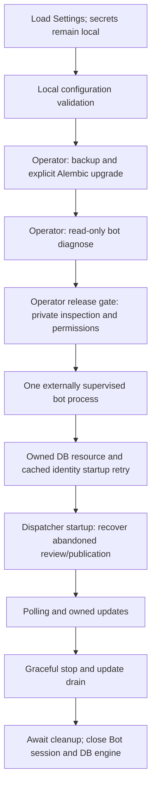
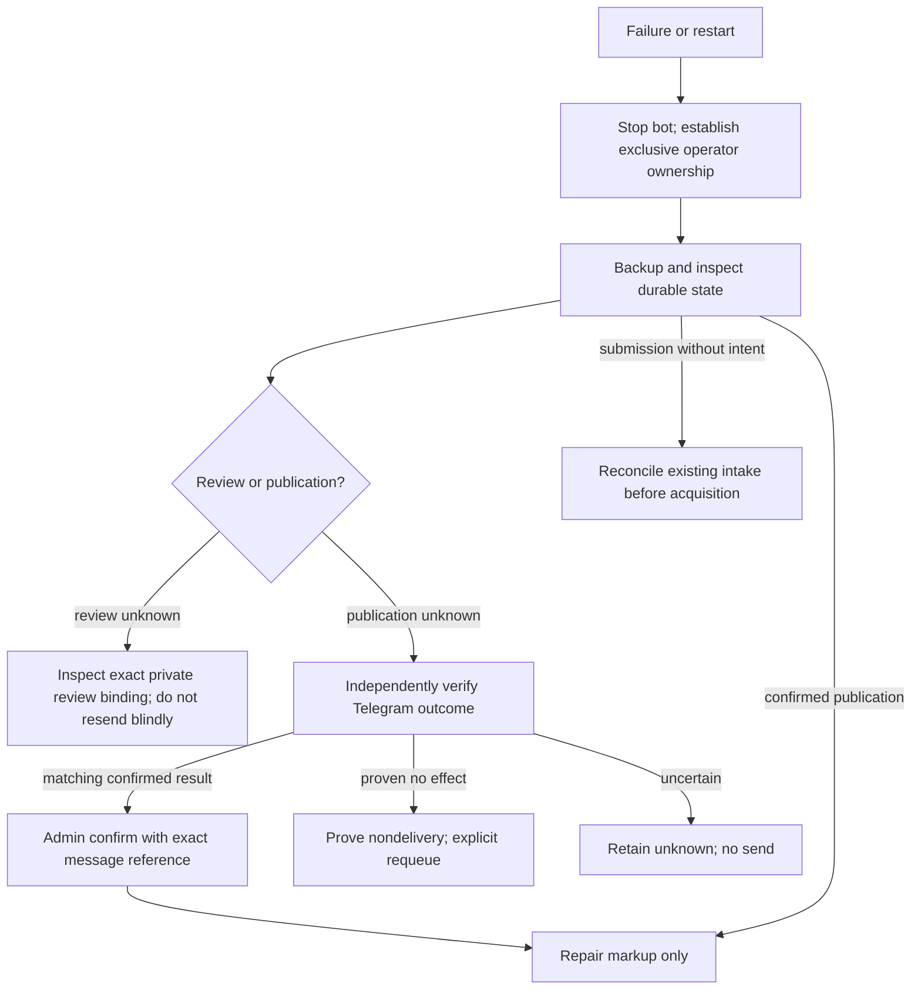

# Single-process operational workflow

Baseline `2b347bc`; this is an operational model and qualification register, not
evidence of a deployed supervisor, a successful restore or production readiness.
See [workflow states](WORKFLOW_MAP.md), [publication contract](PUBLICATION_CONTRACT.md),
[transport guidance](BOT_API_TRANSPORT.md) and [review approval](REVIEW_APPROVAL.md).

## Startup and shutdown

Migration/diagnosis/release gates above are operator steps, not enforced startup
pipeline steps. [run_bot](../cats_channel/bot/application.py) wires persistence and
resource disposal; it does not deploy a supervisor or automatically run migrations.
Public isolation/permission enforcement is proposed PR C. A successful preflight
is a point-in-time read, not a sustained connectivity guarantee or permission grant.

| Concern | Current behavior / evidence | Missing qualification or control |
| --- | --- | --- |
| Settings/secrets | [Settings](../cats_channel/config.py), safe typed errors | explicit public/private mode and fail-closed isolation |
| Migrations | [Alembic versions](../alembic/versions/), SQLite and PostgreSQL tests | operator migration version/readiness procedure and restore rehearsal |
| Identity/transport | bounded cached getMe recovery and separate time budgets; [tests](../tests/test_bot_transport.py) | sustained connectivity qualification |
| Destination permissions | [diagnose_bot_api](../cats_channel/bot/preflight.py), read-only getChat/getChatMember | mandatory startup isolation/permission check |
| Poller ownership | application instance runs once, in-process coordinators | host-level exclusive supervisor/second-process rejection; no multi-worker support |
| Shutdown | [BotApplication](../cats_channel/bot/application.py), shared cancellation-resistant cleanup; [tests](../tests/test_bot_lifecycle.py) | host termination/timeout and fresh-process deployment acceptance |
| Review recovery | abandoned sending becomes unknown; approving becomes needs_reconciliation | operator binding/decision recovery UI and complete rejection restart coverage |
| Publication recovery | [admin CLI](../cats_channel/publication/admin.py) and [tests](../tests/test_publication.py) | consolidated operational acceptance with independently verified outcomes |
| Backup/restore | SQL-backed state and operator guidance | disposable SQLite/PostgreSQL restore/checksum/migration/readback rehearsal; no successful restore claimed here |
| Rollback | versioned migrations and explicit operator control | tested application/schema compatibility and rollback decision matrix |
| Incidents | allowlisted diagnostics and offline regression tooling | consolidated incident ledger connecting revision, phase, certainty, regression and acceptance |

## Recovery decision tree

`--bot-stopped` is an operator assertion, not a distributed lock. Never run
recovery concurrently with polling. Do not use Bot API history absence or a timeout
as proof of non-delivery. No SQL transaction spans a Telegram operation. A failed
notification or markup edit cannot reverse a durable decision or resend media.

## Small reliability slices for #9

1. After PR B rejection and PR C isolation, add one documented host supervision
   option with explicit single-instance ownership, graceful-stop timeout and
   restart/readiness tests. Keep DB/backend policy unchanged.
2. Disposable backup/restore qualification: seed submissions/intents/reviews and
   confirmed/unknown publications; stop writers; backup; restore to a different
   disposable path/database; verify migration head, counts, relations, terminal
   rejection and unknown states. Restart must not send media. Compare stored
   evidence without exposing secrets. Document rollback compatibility separately.
3. Add bounded operator review reconciliation over existing durable records.
   Require exact binding evidence, version CAS and repeat-safety; no generic resend.
4. Maintain sanitized incident records with revision, state, effect certainty,
   reproduction, regression and requalification. Preserve failed CI attempts.

These are proposed independently reviewable PR D slices. No live DB backup,
restore, deployment, Redis, Kubernetes or multi-worker change is performed by
this documentation PR. Public release remains blocked pending #8/#9 qualification.

## Verification ownership

| Gate | Existing command / test ownership |
| --- | --- |
| Locked environment | uv sync --locked --all-extras; Python 3.11 |
| Unit/integration and SQLite migration behavior | uv run --frozen pytest; persistence, reply-chain and publication migration tests |
| Real dispatcher with fake transport | test_bot_submission_intake*, test_review_approval, test_telegram_hosted_reuse, test_aiogram_publisher |
| PostgreSQL concurrency/migrations | existing CI postgres job with disposable PostgreSQL 16; explicit test URL and disposable flag |
| Lint/format | uv run --frozen ruff check .; uv run --frozen ruff format --check . |
| Context records/derived documents | project_context.py validate; generate --check; CI context regressions repeated twice |
| Privacy/error boundaries | test_diagnostics, test_bot_transport and publication logging tests; these are not a comprehensive secret scanner |
| Developer process/MCP lifecycle | test_mcp_tools, test_mcp_handshake, test_offline_checks; independent from bot runtime |

The existing [.github/workflows/ci.yml](../.github/workflows/ci.yml) already owns
Ubuntu, Windows and PostgreSQL gates. No duplicate jobs or new analysis framework
are needed for this map. Local skips and failures must be reported independently
of exact-head CI. An initial failure remains evidence even if an authorized retry passes.
