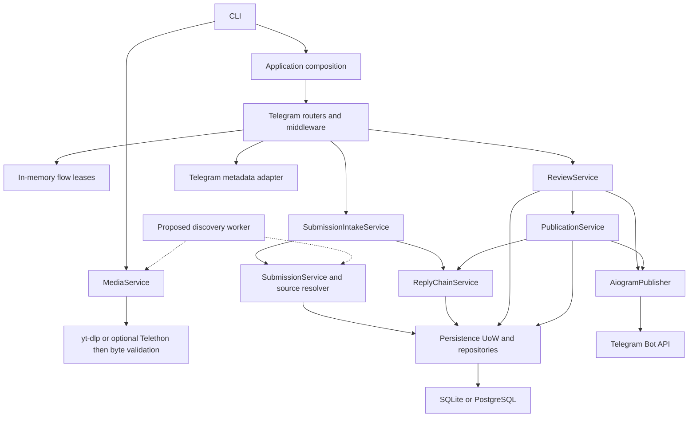
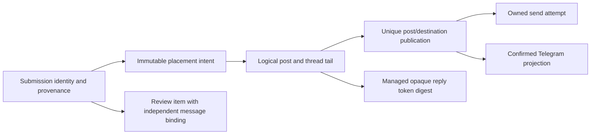

# Repository map

Inspected baseline: `2b347bc2c64c43e621723646411f483726c99f20` (PR #40 merge).
PR #39 is merged at `645229a`. This map describes code at that baseline; proposed
rejection, public isolation and channel discovery are explicitly identified below.

## Component index

Paths are relative to this document. Services own transitions; repositories own
atomic storage operations. Telegram coordinates project internal identities.

| Component | Source / important interface | Responsibility and state | Called by | Tests | Status |
| --- | --- | --- | --- | --- | --- |
| Entry point | [__main__](../cats_channel/__main__.py), [CLI](../cats_channel/cli.py) | Parse one selected admin action; safe reports | console script | [CLI examples](../tests/test_example.py) | implemented; no discover command |
| Composition | [application](../cats_channel/bot/application.py), create_bot_application/run_bot | Own Bot, DB resource, services and polling cleanup | CLI | [application](../tests/test_bot_application.py), [lifecycle](../tests/test_bot_lifecycle.py) | implemented |
| Dispatch | [dispatcher](../cats_channel/bot/dispatcher.py), [handlers](../cats_channel/bot/handlers.py), [routers](../cats_channel/bot/routers/) | Transport routing, admin/private access and error boundaries | polling | [entry contracts](../tests/test_bot_entry_contracts.py) | implemented |
| Flow admission | [flow](../cats_channel/bot/flow.py), FlowLease/PrivateFlowCoordinator/VideoArrivalMiddleware | In-memory generations, replacement/cancel, commit guard | routers/middleware | [concurrency](../tests/test_reply_entry_concurrency.py) | implemented; pre-commit memory is not restart durable |
| Telegram media | [telegram_media](../cats_channel/bot/telegram_media.py) | Hosted metadata evidence; legacy byte adapter retained | intake acquisition callback | [hosted reuse](../tests/test_telegram_hosted_reuse.py), [byte adapter](../tests/test_telegram_media_adapter.py) | two explicit paths |
| Local media | [MediaService](../cats_channel/services/media_service.py), [media](../cats_channel/media.py), [library](../cats_channel/library.py) | Single-video acquisition, full decode and atomic local-library integrity | CLI/admin/local adapter | [service](../tests/test_service.py), [library](../tests/test_library.py) | implemented; not channel discovery |
| Optional downloader | [telegram_downloader](../cats_channel/adapters/telegram_downloader.py), [connection](../cats_channel/adapters/telethon_connection.py) | Correlated third-party replies, Telethon ownership and cleanup | MediaService backend | [downloader](../tests/test_telegram_downloader.py), [connection](../tests/test_telethon_connection.py) | optional; no identity fabrication |
| Source/submission | [entities](../cats_channel/submissions/entities.py), [resolvers](../cats_channel/submissions/resolvers.py), [SubmissionService](../cats_channel/submissions/service.py) | Stable source resolution, bounded handoffs and submission acceptance | intake/local callers | [submission service](../tests/test_submission_service.py), [contracts](../tests/test_submission_contracts.py) | implemented |
| Bot intake | [SubmissionIntakeService](../cats_channel/intake/service.py) | Reconcile inbound projection, accept durable submission, create immutable intent | post router | [persistence intake](../tests/test_bot_submission_intake_persistence.py) | implemented; partial boundary reconciled |
| Logical graph | [ReplyChainService](../cats_channel/reply_chains/service.py), [resolver](../cats_channel/reply_chains/resolver.py) | Normal tail at finalization, immutable exact parent, opaque token authorization | intake/publication/entry resolver | [reply chains](../tests/test_reply_chains.py) | implemented |
| Review | [ReviewService](../cats_channel/review/service.py), [callbacks](../cats_channel/bot/routers/review.py) | Review delivery ownership and admin approval audit | intake/post router/callback | [review](../tests/test_review_approval.py) | approve-only; rejection proposed |
| Publication | [PublicationService](../cats_channel/publication/service.py), [coordinator](../cats_channel/publication/coordinator.py) | Attempt claim, exact parent gating, confirm projection, unknown reconciliation, markup repair | review/pilot/admin | [publication](../tests/test_publication.py) | implemented; single process |
| Bot API adapter | [AiogramPublisher](../cats_channel/adapters/aiogram_publisher.py) | Actual media/markup calls; policy preflight | review/publication | [publisher](../tests/test_aiogram_publisher.py) | implemented |
| Persistence | [contracts](../cats_channel/persistence/contracts.py), [models](../cats_channel/persistence/models.py), [UoW](../cats_channel/persistence/database.py), [repositories](../cats_channel/persistence/) | SQLAlchemy records, CAS, uniqueness; service-owned commit/rollback | services | [persistence](../tests/test_persistence.py), [PostgreSQL](../tests/test_postgres_persistence.py) | SQLite/PostgreSQL |
| Migrations | [versions](../alembic/versions/) | 0001 foundation, 0002 source submissions, 0003 graph, 0004 intake, 0005 publication, 0006 review | explicit Alembic command | [migrations](../tests/test_publication_migrations.py) | no discovery/rejection migration yet |
| Config/transport | [Settings](../cats_channel/config.py), [transport](../cats_channel/bot/transport.py), [preflight](../cats_channel/bot/preflight.py) | Secret wrappers, route/time budgets, read-only diagnosis | composition/CLI/adapters | [transport](../tests/test_bot_transport.py) | public isolation startup enforcement missing |
| Diagnostics/recovery | [diagnostics](../cats_channel/diagnostics.py), [admin](../cats_channel/publication/admin.py), [cleanup](../cats_channel/async_cleanup.py) | Allowlisted errors, exclusive operator publication recovery, cancellation drain | services/CLI | [diagnostics](../tests/test_diagnostics.py), [process](../tests/test_process.py) | review recovery UI absent |
| Developer/context | [context CLI](../tools/project_context.py), [store](../tools/context_store.py), [render](../tools/context_render.py), [select](../tools/context_select.py), [regress](../tools/regress.py), [MCP tools](../tools/mcp/) | Schema validation, derived records, bounded developer checks; not product automation | contributors/CI | [context](../tests/test_project_context.py), [MCP](../tests/test_mcp_tools.py) | independent of publishing |
| Future discovery | [#17](https://github.com/SoloMidMiram/CatsChannel/issues/17)–[#22](https://github.com/SoloMidMiram/CatsChannel/issues/22) | Watchlist, scan/classification, ledger/checkpoint, scheduler, gated handoff | proposed worker | offline contracts planned | not implemented |

## Dependencies and boundaries

Handlers translate transport inputs; they do not choose SQL tails or infer a
parent from Telegram history. Publication depends on graph finalization, not the
reverse transport send. Review calls the existing publisher rather than a second
sender. Optional Telethon and external yt-dlp processes belong to acquisition;
discovery must not accidentally invoke those download paths during listing.

## Findings and scope

| Finding | Classification | Evidence / action |
| --- | --- | --- |
| No rejection transition or reason/action audit field in current ReviewItem | confirmed functional gap | review entities/repository; isolated PR B |
| Same review/publication destination accepted; diagnose is separate from polling startup | confirmed release control gap | Settings, preflight, application; isolated PR C |
| Universal media-path decision corrected | resolved documentation mismatch | [decision-024](../project-context/decisions/decision-024.md); preserve old evidence |
| Review reuses approve_pilot-named publication boundary | maintainability improvement | ReviewService.approve; naming alone is not an authorization defect |
| Per-thread locks plus DB CAS, one process only | deliberate architectural tradeoff | publication coordinator/repository; do not add multi-worker coordination speculatively |
| bot.lifecycle reexports shared cleanup | compatibility boundary | module exports; not proven dead code |
| Operations checklist underspecifies backend qualification versus deployment | documentation mismatch | existing OPERATIONS.md; [operational workflow](OPERATIONS_WORKFLOW.md) |
| Future discovery absent despite single-URL Shorts support | deferred enhancement | CLI parser and media.youtube_url; #18–#22 |

No import-cycle defect or dead-module removal is asserted from a directory listing.
Existing factories are sufficient for this map; a custom AST framework would not
prove dynamic DI/state ownership and is not justified. Keep maps linked to tests
and review them when interfaces change. Generated context files must be produced
by the existing context CLI, not hand-edited.

See [workflow map](WORKFLOW_MAP.md), [operations](OPERATIONS_WORKFLOW.md) and
[Shorts investigation](YOUTUBE_DISCOVERY_INVESTIGATION.md).

## Independent delivery plan and acceptance register

| Slice | Base / dependency | Required result before review completion |
| --- | --- | --- |
| PR A: these maps | merged main 2b347bc | source links, explicit current/proposed diagrams, context generation and existing CI |
| PR B: #8 audited rejection | current implementation baseline; maps are documentation only | migration/action/reason audit; one approve/reject decision CAS; dispatcher, SQLite/PostgreSQL race/rollback/restart/notification-failure tests; zero rejected placement/publication/media send |
| PR C: #8 isolation | B if its callback/state changes are needed; otherwise explicit main baseline | public mode requires separate private inspection, numeric destinations and read-only startup permission verification; narrow explicit private-pilot mode; fail closed, no sends |
| PR D: #9 reliability | reviewed B/C interfaces | independent supervision, disposable restore, review recovery and incident-ledger slices described in operations map; no infrastructure redesign |
| Discovery #18–#21 | independent of B/C | stable source contract then adapter/ledger then scheduler; metadata only; no scheduler in this assignment |
| Discovery #22 | durable acquisition/submission and review acceptance | rights/eligibility opt-in, idempotent pending-review handoff; no automatic approval |

Security blockers: missing rejection and enforced public isolation (#8).
Correctness/concurrency blockers: complete approve/reject race and restart
qualification, explicit submitter acknowledgement, navigation acceptance (#7/#8).
Reliability blockers include external exclusive poller ownership and operator
recovery acceptance (#9). Honey's public identity and loaded Shorts links were
verified in the browser. The extractor route and scheduled catch-up remain unqualified.
These are acceptance gaps, not evidence that every existing invariant is broken.

Smallest next implementation milestone: audited rejection through the current
review service, followed by enforced startup isolation. Maps do not grant release,
formal acceptance, automatic merge or live-operation authority.

## D1 discovery addition

The independent [approved watchlist](DISCOVERY_WATCHLIST.md) adds the authorized
`cats_channel.discovery.service.WatchlistService` application API and the existing
UoW `watchlist` repository. Migration `0008_discovery_watchlist` owns the canonical
registry, pending requests, serialization row and bounded history. Scanner input
filters resolved/enabled/unretired channels; listing, ledger, scheduling and
acquisition remain future work. This addition supersedes only the map's earlier
claim that the watchlist is absent; historical observations remain intact.
