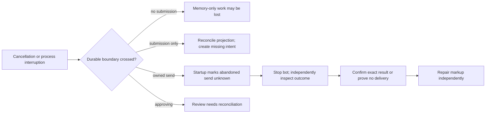
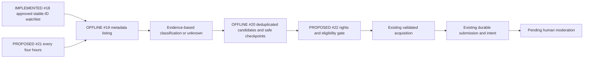

# Workflow map

Baseline: `2b347bc`. [Component/source index](REPOSITORY_MAP.md).
Solid edges describe current boundaries; explicitly labelled proposals are future work.
Human approval remains mandatory for the product review workflow. The restricted
admin pilot command is an explicit override, not an automatic approval policy.

## End to end and durability

```mermaid
flowchart LR
  U[Telegram update] --> Auth[Admin/private admission]
  Auth --> Entry[Source or exact-parent selection]
  Entry --> Media[Hosted metadata or local byte validation]
  Media --> S[Committed submission and inbound projection]
  S --> I[Committed placement intent]
  I --> R[Private review copy]
  R --> A[Human admin approval audit committed]
  A --> P[Logical post finalization]
  P --> Claim[Durable publication attempt]
  Claim --> Send[Bot API send]
  Send --> C[Confirmed destination projection]
  C --> M[Reply/navigation markup]
  R --> Reject[Audited rejection: no placement or publication]
```



[Intake.process](../cats_channel/intake/service.py) reconciles the private inbound
projection before acquisition. SubmissionService commits submission/projection;
intent creation is a subsequent durable boundary. Replays can recover the missing
intent without reacquiring media. Do not imply a transaction spans acquisition or
the two service commits. Before submission commit, flow/FSM/deferred updates are
memory only and can be lost on restart. Pending acknowledgement is not publication
confirmation; review-caption/admin callback updates are not submitter notifications.

```mermaid
flowchart TD
  Normal[/post] --> Choose[Explicit source selection]
  Choose --> NormalIntent[Normal intent: no early tail selection]
  Reply[Opaque exact-post link] --> Resolve[Authorize confirmed internal target]
  Resolve --> Exact[Exact intent retains parent]
  Resolve --> Defer[Video during resolution: captured arrival generation]
  Defer --> Guard[Admit only if resolution succeeds and lease remains current]
  Guard --> Exact
  NormalIntent --> Finalize[At approval: finalize once]
  Exact --> Finalize
  Finalize --> Branch{Intent mode}
  Branch --> Tail[Normal: current logical source tail; advance tail]
  Branch --> Parent[Exact: selected parent; do not advance normal tail]
  Cancel[Cancel or replacement] --> Invalidate[Invalidate old generation and commit guard]
```

FlowLease, VideoArrivalMiddleware and commit_guard prevent stale work adopting a
new entry. Size/duration/dimensions are policy for hosted media; no byte decoding
claim is made. Local-library media retains full decode/digest checks. Source
selection establishes logical placement, not acquired media-source verification.

## Review state ownership

```mermaid
stateDiagram-v2
  [*] --> pending_delivery
  pending_delivery --> sending: commit delivery claim
  sending --> confirmed: exact review binding committed
  sending --> failed: known rejection
  sending --> unknown: ambiguous effect or abandoned startup
  confirmed --> pending_decision
  pending_decision --> approving: admin and version CAS; commit actor/time
  approving --> approved: publication confirmed
  approving --> blocked: parent blocked
  approving --> needs_reconciliation: interrupted or uncertain publication
  pending_decision --> rejected_proposed: PROPOSED reject CAS and audit
```



Delivery and decision are separate fields, not one combined database enum.
[ReviewService](../cats_channel/review/service.py) commits claims before network
calls. Copied callbacks must match stored channel/message/destination, admin and
version. Repeated/nonpending decisions cannot reacquire ownership. Repository CAS
arbitrates competing transactions. Startup recovery never blindly resends unknown
review media. Unknown review binding and interrupted approval need operator work;
there is no full review recovery UI. Approved caption editing is best effort.
Approve/reject competition, safe reasons and rejected terminal markup are proposed
PR B requirements, not existing capabilities.

## Publication and recovery

```mermaid
stateDiagram-v2
  [*] --> pending
  pending --> blocked: exact parent not confirmed
  blocked --> pending: parent confirmed
  pending --> sending: durable attempt CAS
  sending --> confirmed: atomic result and projection
  sending --> failed: proven no effect
  sending --> unknown: ambiguity or interrupted ownership
  unknown --> confirmed: independently verified operator reference
  unknown --> failed: independently proven nondelivery
  failed --> pending: explicit operator requeue
  confirmed --> confirmed: markup repair only; no media resend
```



PublicationService reconciles existing logical placement before finalizing again.
A logical tail is not the last delivered post. Child sends require the exact
parent's confirmed destination projection, with reply fallback disabled. Media
confirmation and navigation/markup are independent; failed edits never resend
confirmed media. Latest-confirmed-reply is a direct-child pointer, not a full index.



## Offline discovery and gated automation



Four-hour scheduling means six intended scans/day, not guaranteed delivery times.
The proposed worker needs overlap ownership, per-channel isolation and paginated
catch-up after downtime. Partial failure cannot advance a checkpoint over unseen
uploads. Candidate discovery does not create a post or authorize media acquisition.

## Automation ownership matrix

| Workflow / trigger | Owner | Durable state | External effect | Failure / retry policy |
| --- | --- | --- | --- | --- |
| /post or opaque entry | flow + intake | none until submission commit, then projection/intent | prompts; hosted metadata checks | invalidate stale lease; replay reconciles first |
| Local media acquisition | MediaService | validated atomic library artifact | yt-dlp/optional Telethon, local processes | bounded owned cleanup; no unreviewed publication |
| Durable intake completion | ReviewService.enqueue | review delivery claim/binding | one private preview | unknown requires reconciliation, no blind resend |
| Admin approve callback | ReviewService + repository | actor/time and decision ownership | invoke publisher, then caption/callback | duplicate/stale safe; notification failure cannot undo decision |
| Admin reject callback | merged PR #42 | terminal audited rejection | terminal markup/notification only | zero post/publication/send; one decision CAS |
| Approved publication | PublicationService | attempt/result/projection | channel video, then markup | uncertainty remains unknown; operator decision required |
| Markup repair | publication admin/service | markup/token ownership | edit known confirmed message | repair only; never resend video |
| Startup | BotApplication hooks | abandoned review/publication updates | identity lookup and polling | read-only identity retry; polling owns its backoff |
| Four-hour discovery | proposed #21 worker | offline-qualified scan/candidate/checkpoint ledger | gated metadata-only YouTube reads | no overlap; bounded catch-up/retry categories |
| Recovery | explicit operator | evidence-based reconciliation | optional explicit repair or known-safe retry | exclusive stopped-bot ownership, never infer non-delivery from absence |

## D1 discovery addition

The independent [approved watchlist](DISCOVERY_WATCHLIST.md) adds the authorized
`cats_channel.discovery.service.WatchlistService` application API and the existing
UoW `watchlist` repository. Migration `0008_discovery_watchlist` owns the canonical
registry, pending requests, serialization row and bounded history. Scanner input
filters resolved/enabled/unretired channels; listing, ledger, scheduling and
acquisition remain future work. This addition supersedes only the map's earlier
claim that the watchlist is absent; historical observations remain intact.
