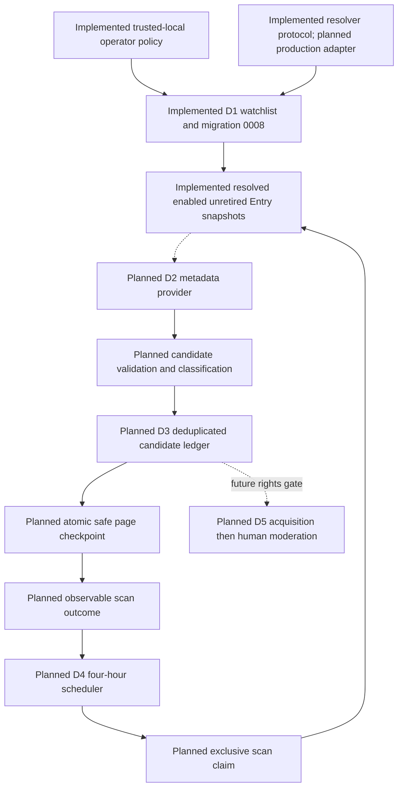

# Discovery automation architecture

Baseline `0d498a4` implements [WatchlistService](../../cats_channel/discovery/service.py),
[domain DTOs](../../cats_channel/discovery/domain.py),
[repository protocols](../../cats_channel/discovery/contracts.py),
[SQLAlchemy registry](../../cats_channel/persistence/discovery_repositories.py) and
[migration 0008](../../alembic/versions/0008_discovery_watchlist.py).
The [D1 contract](../DISCOVERY_WATCHLIST.md) defines trusted-local authorization,
normalization, version checks, bounded history and scanner filtering. Provider
awaits occur outside database transactions. Registry writers serialize through the
existing UoW and control row. No production resolver, scanner, candidate ledger,
scan-run store, scheduler or acquisition bridge exists at this baseline.



The scheduler triggers the scanner; it does not decide source identity or eligibility.
Observed outcomes determine the next eligible attempt time. No discovery component
chooses a Telegram reply parent or approves publication.

## Provider and normalization contract

Add a protocol beside the existing contracts in #19.

```python
async def list_page(
    entry: Entry, cursor: str | None, configuration: ProviderConfiguration
) -> PageResult: ...
```

Use existing Candidate, PageResult, Status and ProviderConfiguration DTOs. Every
candidate must match entry.channel_id, have a valid video ID and constructed URL,
bounded title/evidence, timezone-aware timestamps and finite optional duration.
Do not infer source identity from handles or titles. Map rendered membership to
shorts_tab, duration-based hints to short_candidate, and insufficient evidence to
unknown. Never infer not_short solely from missing membership in an incomplete tab.

Define ScanPolicy.page_budget as the maximum candidate items considered per run,
matching D1's documented 30-item default. Count rejected/duplicate provider entries
against an additional raw-item cap so malformed output cannot create unbounded
work. ProviderConfiguration.request_budget independently limits outbound calls;
also enforce page-count, elapsed-time and output-byte ceilings. Document this
interpretation before implementing adapters because the field name is ambiguous.

## Page completion and scan completion

PageResult.state=complete means one page was retrieved and validated completely.
It may still have next_cursor. The existing checkpoint_may_advance property permits
safe page progress only; it does not prove the entire scan is complete. A partial
page may contain usable observations but retains the cursor used to request it.
A failed page provides a bounded failure classification, never an empty success.
Cancellation propagates and leaves committed prior pages intact.

Proposed run outcomes are running, completed, budget_exhausted, partial, failed,
cancelled and interrupted. Mark completed only after a terminal provider page or a
documented safe coverage boundary. Budget exhaustion leaves catch-up pending.
Provider order and publication dates alone are insufficient completeness evidence.

Persist a scan envelope in #20 with registry UUID, immutable channel ID, adapter
and version, configuration/policy fingerprint, input and next cursor, page index,
coverage target, counts, owner/version, timestamps and bounded failure reason.
Bind opaque cursors to that envelope. Reject wrong-provider/source/version reuse.
Detect repeated cursor loops. On expiry, restart from a bounded overlapping window
and deduplicate; preserve the previous completed watermark until coverage is proven.
If the budget cannot reach the old boundary, expose backlog and request bounded
operator backfill. Never silently skip older unseen uploads.

Within one UoW, upsert validated page observations and advance its safe cursor
with owner/version CAS. A crash before commit replays the page; a crash after
commit resumes its saved next cursor. Failed/partial pages cannot move the completed
watermark. Terminal completion updates last_successful_full_scan separately.

## Ownership, storage and failures

| Issue | Sole responsibility |
| --- | --- |
| #18 | existing canonical registry plus production channel resolution |
| #19 | provider listing, normalization and classification |
| #20 | candidate/run/checkpoint tables referencing watched_channels.id |
| #21 | one-shot execution, exclusive claim, scheduling and observability |
| #22 | separately authorized rights/eligibility gate and acquisition handoff |

Candidate uniqueness is (provider, video_id). Preserve immutable source association;
conflicting channel attribution is ambiguous/quarantined, never reassigned silently.
Keep first_seen, last_seen, latest metadata and observation provenance distinct.
Preserve prior known metadata when later providers omit it, while recording the
new observation's nulls and timestamp. Do not create CatVideoSubmission at discovery.
Recheck enabled/retired state and identity before committing work or scheduling a
future handoff. A watchlist snapshot does not confer continuing authorization.

Map rate/quota to rate_limited, TLS/connection/timeout to temporary_failure,
unusable input to invalid_input, and identity conflicts to ambiguous. Unavailable
means inaccessible according to evidence; do not invent a private/deleted cause.
Keep authentication/configuration, cursor expiry, malformed output and quota subtype
as bounded scan reason codes. Unexpected exceptions are sanitized temporary failures.
One channel's failure does not discard other channels' committed pages.

Start with no automatic inline retries. #21 can persist an explicit bounded policy
for idempotent reads with request-budget accounting, capped attempts, jitter and
retry-after. Quota exhaustion waits for the provider's permitted retry window;
credential/configuration failures require operator correction. Never disable TLS
verification or silently change adapter. No DB transaction spans provider I/O.

## Eventual single-process execution

One scanner process uses the existing database and a short transactional run claim
with owner/version fencing. A single host lock prevents overlapping invocations;
restart marks abandoned owners interrupted before resuming safe boundaries. Any
future expiring lease requires fencing every checkpoint commit so a stale owner
cannot overwrite a newer run. Keep concurrency at one initially.

Propose one Windows Task Scheduler deployment for this Windows-oriented host,
invoking a future discover --once every four hours in UTC. The operator must supply
a persistent DB path, locked environment, logs and secret configuration before
activation. Host sleep/offline time creates backlog; next invocation performs
bounded catch-up, not one scan per missed tick. No schedule is created here.
Use structured run/source counts, failure categories, backlog and last-full-scan
age without credentials or unnecessary response bodies. dry-run may emit a report
but writes no candidate, checkpoint, queue or watchlist mutation.
